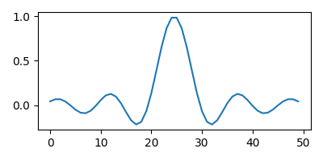

* Python in org-mode

** Configuration

#+begin_src elisp
  (org-babel-do-load-languages
   'org-babel-load-languages
   '((python . t)))
#+end_src

In non-session mode, when :results is value (default), a return
statement is needed, unlike in session mode where the last statement's
value is returned.

Example:

#+begin_src python
  def foo(x):
      if x > 0:
	  return x + 1
      else:
	  return x - 1
  return foo(5)
#+end_src

#+RESULTS:
: 6

#+begin_src python :session
  def foo(x):
      if x > 0:
	  return x + 1
      else:
	  return x - 1
  foo(5)
#+end_src

#+RESULTS:
: 6

The python header argument :python specifies the python command
to be used. In the example below we use python in a virtualenv.

To return plots, save the plot to a file, return the file name and
set :results file

#+begin_src python :python /home/krm/.envs/matplotlib/bin/python :results file
  import matplotlib
  import matplotlib.pyplot as plt

  fig=plt.figure(figsize=(3, 2))
  plt.plot([1, 3, 2])
  fig.tight_layout()

  fname = "img/example_plot.pdf"
  plt.savefig(fname)

  # return file name to org
  return fname
#+end_src

#+RESULTS:
[[file:img/example_plot.pdf]]

Use :results output to show stdout

#+begin_src python :results output
  print("hello, world!")
#+end_src

#+RESULTS:
: hello, world!

Python can also be called inline e.g.

Two plus two equals src_python{return(2+2)} {{{results(=4=)}}}

when exported, it becomes

~Two plus two equals 4~

Data can be extracted from an org-mode table e.g.

#+tblname: data_table
| a | 1 |
| b | 2 |
| c | 3 |

#+begin_src python :var val=1 :var data=data_table
  # return row specified by val
  return data[val]
#+end_src

#+RESULTS:
| b | 2 |

#+begin_src python :var data=data_table :results output
  # inspect type
  print(type(data))
  print(data[0])
#+end_src

#+RESULTS:
: <type 'list'>
: ['a', 1]

Another plotting example:

#+begin_src python :python /home/krm/.envs/matplotlib/bin/python :results file
  import numpy
  import matplotlib

  matplotlib.use("Agg")
  import matplotlib.pyplot as plt

  fig = plt.figure(figsize=(4, 2))
  x = numpy.linspace(-15, 15)
  plt.plot(numpy.sin(x)/x)
  fig.tight_layout()

  file_name = "img/example-plot.png"

  plt.savefig(file_name)
  return file_name

#+end_src

#+RESULTS:

